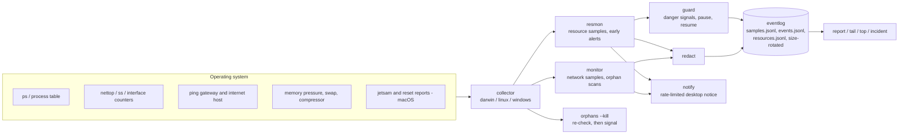

# How netwatch works

netwatch is one Go program (`cmd/netwatch`) built from small packages under `internal/`. The same binary is the background service (`netwatch run`), the command-line tool (`report`, `orphans`, `top`, `incident`, ...), and the installer (`install`, `uninstall`, `status`). Platform differences sit behind one collector interface, so the policy code is shared and tested on every OS.

## Components



| Package | Role |
| --- | --- |
| `internal/collector` | Interface to the OS, with a `darwin`, `linux` and `windows` implementation chosen at build time (`select_*.go`). |
| `internal/monitor`, `health`, `netrate` | Network sampling loop; turns ping results into `DEGRADED` and `RECOVERED`; turns cumulative per-process counters into rates and detects `NEW_NET_APP`. |
| `internal/procscan` | Classifies a process table into orphans and runaways, and checks that a process about to be signalled is still the one the user saw. |
| `internal/resmon`, `resources`, `sampler`, `alerts`, `tracker`, `attrib` | Memory and process sampling every 10 s (every 2 s under pressure), early-warning alerts, and attribution of a process to an app and, for Claude Code tool calls, to the agent that started it. |
| `internal/danger`, `guard`, `eligibility`, `guardmode`, `shapecheck`, `budget` | The memory guard: pure danger-signal functions, the pause/resume state machine, the safety boundary that decides which process groups may ever be signalled, the mode file, the Claude Code shape check, and declared-budget handling. |
| `internal/incident`, `jetsam`, `transcript` | After a crash, join macOS jetsam and reset reports with netwatch's own samples and with the tool calls found in Claude Code transcripts. |
| `internal/redact`, `safeio` | Mask secrets in command lines before they are logged or printed; one hardened reader/writer for every shared or untrusted file (size caps, mode checks). |
| `internal/eventlog`, `record`, `report` | Size-rotated JSONL logs, the record schemas, and the `report` summaries (text and `--json`). |
| `internal/config`, `notify`, `execx`, `selfusage` | Configuration with defaults and clamping, notification rate limiting, helper commands with deadlines, and netwatch's own CPU accounting. |

## Data flow

1. The service samples on a timer: network health every `interval` seconds (10 by default), per-process traffic every `net_every` seconds while healthy, a process scan every `orphan_every` seconds, and resources every `resources_every_s` seconds.
2. Collectors return plain values. Policy code (health, netrate, procscan, danger, alerts) is pure and takes those values as input, which is why it is unit-tested without touching the host.
3. Every command line passes through `redact` before it reaches a log, a notification or terminal output.
4. Events and samples are appended to JSONL files in the log directory (`~/Library/Logs/netwatch/` on macOS, `$XDG_STATE_HOME/netwatch/` on Linux, `%LOCALAPPDATA%\netwatch\logs\` on Windows). Files are mode `0600` in a `0700` directory on macOS and Linux and rotate at `max_log_mb`.
5. `report`, `tail`, `top` and `incident` read those logs, or the live system for `top`, and print text or JSON.

## Safety design

- The orphan scanner only lists. `orphans --kill` needs `--pid`, `--match` or `--all`, refuses to run as root, re-reads the process table, and checks start time and command line again immediately before signalling. A changed process (for example a reused PID) is skipped.
- The memory guard acts on the host's danger, not on job size. `eligibility` limits it to Claude Code tool-call jobs and excludes terminals, other apps, other users, system processes, and virtual machines, containers and databases. Details and rollback steps are in the README [Memory guard](../README.md#memory-guard) section.
- On macOS the guard can only pause. Kill needs the job's environment to be readable, and macOS does not allow that for system binaries such as `/bin/zsh`.

## Run, test, build

```sh
go run ./cmd/netwatch once                 # one sample and one scan, then exit
go test ./...                              # unit tests plus this OS's collector tests
go vet ./... && staticcheck ./...
GOOS=windows go vet ./... && GOOS=linux go vet ./...
scripts/build-release.sh v0.0.0-dev dist   # cross-build all release archives
```

Go 1.26 or newer is required (`go.mod`). The CI workflow (`.github/workflows/ci.yml`) runs gofmt, vet, staticcheck, `go test -race` and a smoke run on Linux, macOS and Windows, and cross-builds five targets from Linux. Releases are built with `scripts/build-release.sh` and uploaded to GitHub Releases with a `SHA256SUMS` file; the release workflow in the repository is manual-dispatch only.
